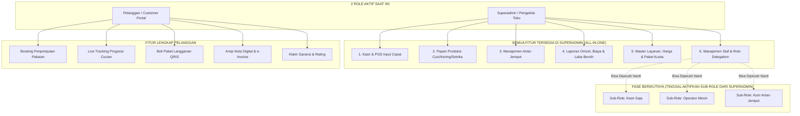
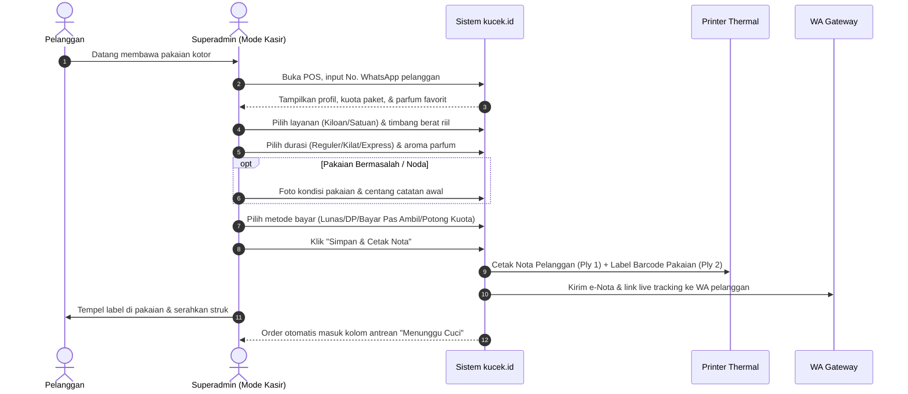
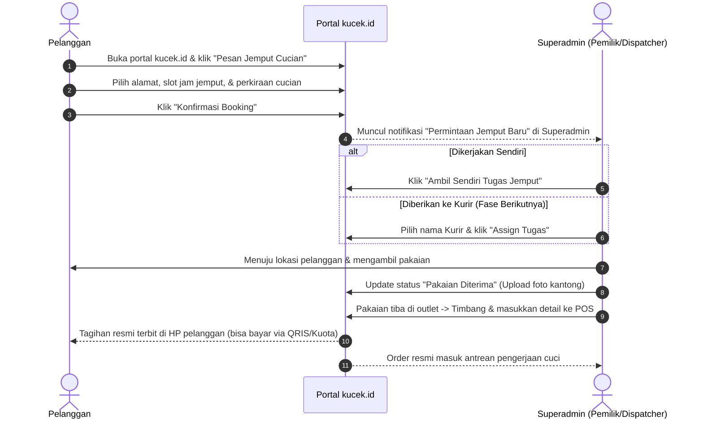
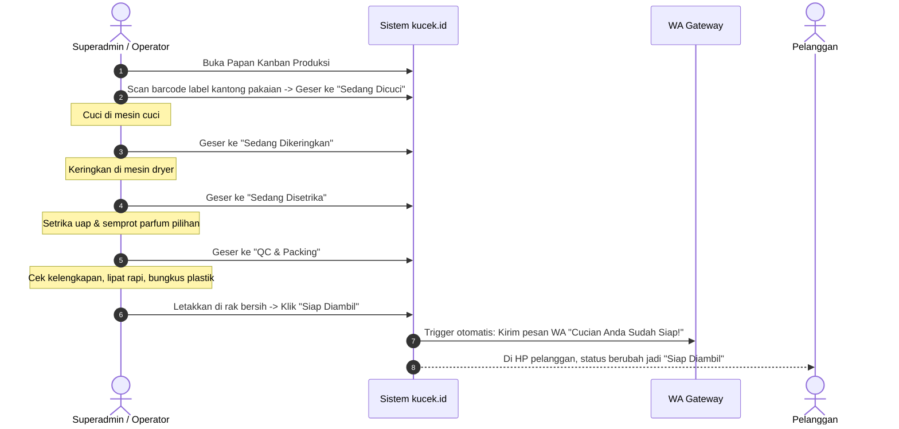
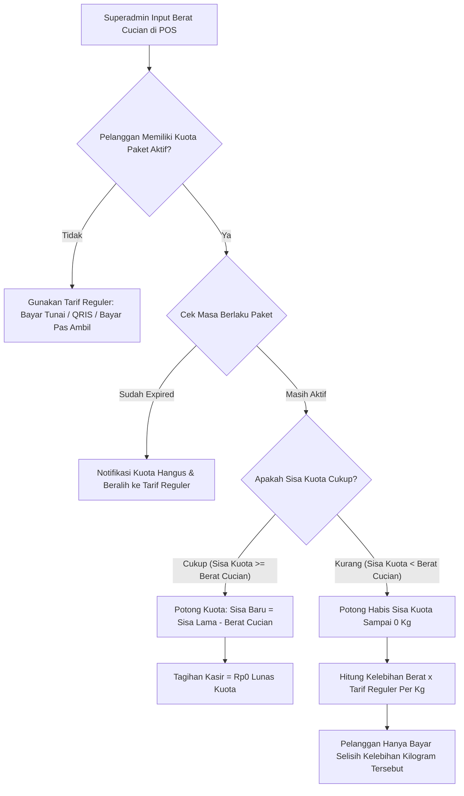
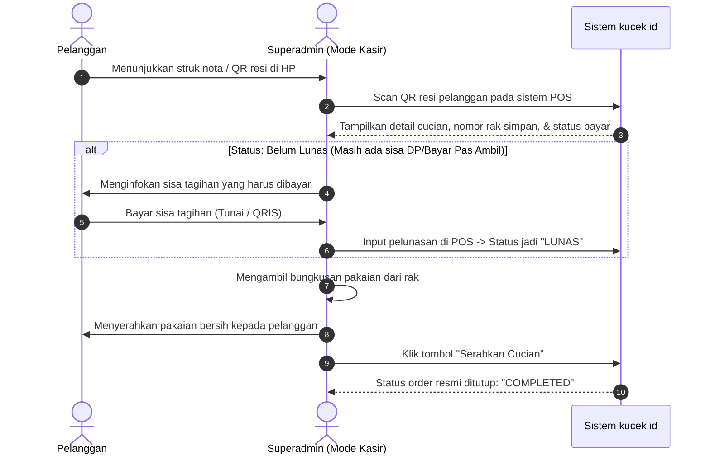

# PRODUCT REQUIREMENTS DOCUMENT (PRD)
## Project: kucek.id — Platform Manajemen Laundry & Pengalaman Pelanggan Modern

* **Document Version:** 2.1.0 (2-Role Active Architecture with Future-Proof Superadmin)
* **Date:** 2026-11-27
* **Status:** Finalized & Ready for Development
* **Target Audience:** Engineering Team, UI/UX Designer, Product Owner, QA / Tester

---

## 1. Executive Summary & Konsep Arsitektur 2-Role

### 1.1 Visi & Konsep Utama
Sistem **kucek.id** dirancang dengan pendekatan **"2 Active Roles with Future-Proof Sub-Role Architecture"**:

* **ROLE 1: SUPERADMIN (All-in-One Store Management)**
  Satu pintu masuk untuk seluruh operasional toko laundry. Di awal, pemilik toko dapat menjalankan **semua fungsi operasional** (Kasir POS, Antrean Produksi Cuci/Setrika, Pengaturan Kurir Antar-Jemput, Laporan Keuangan, dan Pengaturan Harga) langsung dari 1 akun Superadmin tanpa ribet ganti-ganti login.
  * *Disiapkan untuk Fase Berikutnya:* Di dalam Superadmin, modul **Manajemen Staf & Hak Akses (RBAC)** sudah lengkap 100%. Begitu bisnis berkembang dan merekrut karyawan, Superadmin tinggal membuat akun khusus (Kasir, Operator Cuci, atau Kurir) yang hak aksesnya otomatis terbatasi sesuai tugas masing-masing tanpa perlu merombak sistem dari nol.

* **ROLE 2: PELANGGAN (Customer Self-Service Portal)**
  Aplikasi mandiri untuk pelanggan: pesan antar-jemput, live tracking cucian, beli paket kuota langganan kiloan via QRIS, riwayat e-Nota, serta klaim garansi 24 jam.



---

## 2. Fitur Komplit 100% Superadmin (All-in-One + Persiapan Sub-Role)

Superadmin memiliki kontrol 100% atas seluruh operasional bisnis laundry.

---

### A. Modul Kasir & Point of Sale (POS) Terintegrasi
Superadmin dapat langsung bertindak sebagai kasir di outlet:
1. **Buka/Tutup Kas Harian (Cash Drawer):**
   * Input modal uang receh/kembalian awal shift.
   * Hitung uang fisik laci di akhir hari dengan deteksi otomatis: *Cocok / Selisih Kurang / Selisih Lebih*.
2. **Pencarian & Registrasi Pelanggan:**
   * Ketik nomor WhatsApp atau nama pelanggan &rarr; riwayat dan preferensinya langsung muncul.
   * Jika pelanggan baru, input cepat: Nama & No. WhatsApp (alamat opsional).
3. **Input Layanan Kiloan & Desimal:**
   * Input berat timbangan pakaian (contoh: `3.45 kg`).
   * Validasi batas minimum kiloan toko otomatis (misal: minimal 2.0 kg).
4. **Input Layanan Satuan Berbasis Grid Bergambar:**
   * Tombol cepat dengan gambar item: Jas, Gaun, Bedcover, Sepatu, Karpet, Selimut, Bantal, Boneka, Helm.
5. **Inspeksi Awal & Bukti Foto Pakaian:**
   * Centang tanda kondisi pakaian: *Luntur, Kancing Hilang, Robek, Kain Tipis*.
   * Ambil foto kondisi pakaian langsung via kamera tablet/laptop untuk mencegah komplain pelanggan di kemudian hari.
6. **Pilihan Kecepatan (Durasi) & Parfum:**
   * Durasi: *Reguler (3 hari)*, *Kilat (1 hari)*, *Express (5 jam)* dengan pengali harga otomatis.
   * Dropdown aroma parfum (menampilkan parfum favorit pelanggan secara default).
7. **Skema Pembayaran Fleksibel:**
   * **Tunai (Cash):** Hitung kembalian otomatis.
   * **QRIS / Transfer:** Tampilkan QRIS di layar.
   * **Uang Muka (DP):** Bayar sebagian, sisanya dibayar saat ambil.
   * **Bayar Pas Ambil (COD Outlet):** Biaya Rp0 di awal.
   * **Potong Kuota Langganan:** Kuota kiloan pelanggan terpotong otomatis tanpa uang fisik.
8. **Cetak Nota Struk Thermal 2-Ply (ESC/POS Printing):**
   * **Ply 1 (Struk Pelanggan):** Rincian item, biaya, status lunas, barcode resi, link cek resi.
   * **Ply 2 (Label Kantong Pakaian):** Nomor resi besar, nama pelanggan, pilihan parfum, jumlah kantong (*Kantong 1 dari 2*).
9. **Kirim Nota via WhatsApp Otomatis/Manual:**
   * 1-klik tombol kirim rincian nota & tautan tracking langsung ke nomor WhatsApp pelanggan.

---

### B. Modul Papan Antrean Produksi (Kanban Pengerjaan Cuci-Setrika)
Superadmin dapat mengawasi sekaligus mengoperasikan alur kerja pengerjaan cucian:
1. **Papan Visual 5 Tahap:**
   * `1. Menunggu Cuci (Queued)`
   * `2. Sedang Dicuci (Washing)`
   * `3. Sedang Dikeringkan (Drying)`
   * `4. Sedang Disetrika (Ironing)`
   * `5. QC & Packing (Packing)`
   * `6. Siap Diambil di Rak (Ready for Pickup)`
2. **Operasi 1-Klik / Barcode Scanner:**
   * Geser kartu cucian dengan tombol panah atau cukup scan barcode kantong menggunakan barcode scanner USB/kamera.
3. **Indikator Prioritas Express:**
   * Badge merah berkedip dengan *countdown timer* untuk cucian express agar didahulukan mencucinya.
4. **Trigger Otomatis Notifikasi Selesai:**
   * Begitu cucian dipindah ke kolom `Siap Diambil di Rak`, sistem **otomatis mengirim pesan WhatsApp** ke pelanggan bahwa pakaian sudah wangi dan siap diambil.

---

### C. Modul Pengambilan & Serah Terima Cucian (Pick-up)
1. **Scan Barcode Resi Pelanggan:**
   * Kasir/Superadmin scan QR resi dari HP atau struk fisik pelanggan.
2. **Pengecekan Status Lunas Otomatis:**
   * Jika masih ada sisa tagihan/DP, sistem memblokir tombol serah terima hingga sisa pembayaran dilunasi.
3. **Konfirmasi Selesai:**
   * Klik `Serahkan Cucian` &rarr; Status order resmi ditutup menjadi `COMPLETED`.

---

### D. Modul Logistik Antar-Jemput (Pickup & Delivery Dispatcher)
1. **Daftar Permintaan Penjemputan:**
   * Memantau pesanan jemput pakaian kotor dari aplikasi pelanggan.
2. **Penugasan Kurir (Disiapkan untuk Fase Berikutnya):**
   * Superadmin bisa mengerjakan penjemputan sendiri ATAU memilih kurir yang bertugas (*Assign Driver*).
3. **Pengaturan Tarif Ongkir:**
   * Tarif flat (misal: Rp5.000 flat) atau gratis ongkir jika cucian di atas 8 kg / radius < 2 km.
4. **Navigasi & Kontak:**
   * Tombol navigasi Google Maps/Waze langsung ke titik rumah pelanggan dan tombol chat WhatsApp.

---

### E. Modul Paket Kuota Langganan Kiloan (Subscription Engine)
1. **Pembuatan Produk Paket Hemat:**
   * Buat paket: misal *Paket Mahasiswa 30 Kg (Rp180.000, masa aktif 30 hari)* atau *Paket Keluarga 100 Kg (Rp550.000, 60 hari)*.
2. **Pemotongan Kuota Cerdas:**
   * Saat pelanggan mencuci 4.2 kg, kuota berkurang otomatis menjadi 25.8 kg.
   * Jika kuota sisa 2.0 kg tapi cucian 3.5 kg: Kuota dihabiskan ke 0 kg, sisa kelebihan 1.5 kg otomatis dihitung dengan tarif kiloan reguler.
3. **Monitoring & Koreksi Kuota:**
   * Daftar sisa kuota seluruh member dan tombol koreksi kuota manual jika ada penyesuaian khusus.

---

### F. Modul Manajemen Master Data & Harga (Pricing Engine)
1. **Katalog Kiloan:** Tambah/edit nama layanan kiloan, tarif per kg, dan berat minimal.
2. **Katalog Satuan:** Tambah/edit item satuan (Jas, Gaun, Bedcover, Sepatu, Karpet, dll) beserta tarif per pcs.
3. **Tier Durasi:** Atur pengali tarif untuk paket Reguler, Kilat, dan Express.
4. **Aroma Parfum:** Tambah/nonaktifkan aroma parfum (Sakura, Lavender, Ocean Fresh, Vanilla, Non-Parfum / Baby Safe).
5. **Add-on Khusus:** Biaya pembersih noda membandel (spotting), plastik hanger jas, atau desinfektan.

---

### G. Modul Keuangan, Arus Kas & Laba Rugi
1. **Laporan Arus Kas (Cash Flow):**
   * Rekap uang tunai laci vs uang masuk QRIS/Transfer vs omzet pemotongan saldo kuota.
2. **Pencatatan Biaya Operasional (Expenses):**
   * Catat pengeluaran: Belanja deterjen, pelembut, parfum, gas LPG dryer, plastik, listrik, air, gaji, makan karyawan.
   * Upload foto kuitansi/nota belanja.
3. **Kalkulator Laba Bersih Otomatis:**
   * `Laba Bersih = Total Pemasukan - Total Pengeluaran`.

---

### H. Modul Keamanan, Anti-Kecurangan & Audit Trail
1. **Aturan Pembatalan Nota (*Void*) Ketat:**
   * Transaksi tidak bisa dihapus sembarangan.
   * Pembatalan wajib memasukkan alasan dan PIN otorisasi Superadmin.
2. **Audit Log Permanen:**
   * Setiap aksi void, diskon manual, atau edit timbangan tercatat dengan tanggal, jam, dan ID pelakunya.

---

### I. Modul Marketing, Diskon & Broadcast
1. **Kupon Diskon:** Buat voucher potongan persen atau nominal dengan batas kuota pemakaian.
2. **Poin Loyalitas:** Konfigurasi perolehan poin per transaksi dan katalog penukaran poin.
3. **WhatsApp Broadcast:** Kirim pengumuman promo massal ke nomor pelanggan terdaftar.

---

### J. Modul Manajemen Staf & Delegasi Hak Akses (Persiapan Fase Berikutnya)
Fitur ini sudah ada dan aktif di Superadmin:
1. **Menu Kelola Staf:**
   * Form tambah akun staf baru (Nama, Nomor HP, Email, Password/PIN, dan Pilihan Role).
2. **Preset Role yang Siap Diaktifkan Kapan Saja:**
   * **Sub-Role Kasir:** Hanya bisa buka/tutup shift, input order POS, terima pembayaran, dan serah terima cucian (tidak bisa lihat laba-rugi & hapus nota).
   * **Sub-Role Operator Mesin:** Hanya bisa buka layar papan antrean produksi cuci/setrika dan scan barcode (tidak bisa akses transaksi keuangan).
   * **Sub-Role Kurir:** Hanya bisa buka layar tugas antar-jemput dan navigasi map.
3. **Manajemen Status Akun:**
   * Tombol aktifkan / nonaktifkan staf sewaktu-waktu.

---

## 3. Fitur Komplit 100% Pelanggan (Customer Self-Service Portal)

Portal mandiri pelanggan yang modern, cepat, dan ramah pengguna di layar smartphone:

---

### A. Autentikasi Cepat (Zero Friction)
* Login mudah menggunakan **Nomor WhatsApp (kode OTP)** atau **Login Akun Google**.
* Tanpa perlu mengingat password rumit.

### B. Beranda Pelanggan (Customer Hub)
* **Live Tracking Cucian Aktif:**
  * Widget paling atas dengan progress bar interaktif: `Diterima &rarr; Dicuci &rarr; Disetrika &rarr; Siap Diambil`.
  * Menampilkan estimasi tanggal dan jam selesai.
* **Widget Kuota Paket Langganan:**
  * Menampilkan sisa kuota kiloan aktif (contoh: *Sisa 24.5 / 50 Kg — Berlaku s/d 20 Des 2026*).
* **Widget Poin Reward:**
  * Menampilkan saldo poin loyalitas yang bisa ditukar jadi kupon diskon.
* **Tombol Cepat:**
  * Tombol utama: *"Pesan Jemput Cucian"* & *"Beli Paket Hemat"*.

### C. Booking Antar-Jemput Mandiri (Pickup Request)
* Form pemesanan 3 langkah:
  1. **Pilih Alamat:** Pilih alamat tersimpan (Rumah, Kos, Kantor) atau ketik alamat baru + patokan.
  2. **Pilih Waktu:** Pilih tanggal dan slot jam penjemputan (Pagi 09.00-12.00 / Siang 13.00-16.00 / Sore 16.00-19.00).
  3. **Pilih Estimasi Layanan & Parfum:** Tentukan perkiraan jenis pakaian dan pilih aroma parfum kesukaan.
* Begitu pesanan dikirim, muncul status: *Menunggu Penugasan Kurir &rarr; Kurir Menuju Rumah Anda*.

### D. Pembelian Paket Kuota Kiloan Online
* Katalog paket kuota kiloan hemat yang bisa dibeli sendiri:
  * Pilih paket (misal: *Paket 30 Kg seharga Rp180.000*).
  * Pembayaran instan via **QRIS Dinamis** (GoPay, OVO, ShopeePay, BCA, Mandiri, dll).
  * Begitu bayar berhasil, kuota otomatis bertambah ke akun pelanggan secara detik itu juga (*real-time*).

### E. Riwayat Transaksi & Nota Digital (e-Invoice)
* Arsip seluruh cucian yang pernah dicuci di kucek.id.
* Buka rincian nota: Berat timbangan, item satuan, rincian biaya, nominal DP, sisa yang harus dibayar, dan status lunas.
* Tombol unduh nota format PDF atau simpan gambar ke galeri HP.

### F. Pengaturan Profil & Personalisasi
* Simpan daftar alamat favorit (Rumah, Kos, Kantor).
* Pilih **Aroma Parfum Default** (otomatis terpilih di setiap cucian).
* Catatan preferensi permanen (misal: *Kemeja selalu digantung hanger, deterjen ramah bayi*).

### G. Rating, Review & Form Klaim Komplain 24 Jam
* Beri rating bintang 1 s/d 5 dan ulasan setelah cucian selesai.
* **Form Komplain Garansi 24 Jam:**
  * Pelanggan dapat mengajukan klaim jika ada pakaian yang kurang bersih, luntur, atau tertinggal dalam waktu 24 jam pasca pengambilan.
  * Unggah foto bukti keluhan.
  * Status komplain langsung masuk ke layar Superadmin untuk segera dihubungi dan diberikan solusi (cuci ulang gratis atau ganti rugi).

---

## 4. Alur Kerja Sistem (Workflows)

---

### Alur 1: Transaksi Walk-In Kasir (Drop-off di Outlet)



---

### Alur 2: Booking Antar-Jemput Mandiri (Pickup & Delivery)



---

### Alur 3: Pengerjaan Produksi & Notifikasi Siap Ambil



---

### Alur 4: Pemotongan Kuota Langganan Kiloan



---

### Alur 5: Pengambilan Cucian & Pelunasan (Pick-up)



---

## 5. Aturan Bisnis & Penanganan Kasus Khusus (Business Rules & Edge Cases)

1. **Aturan Berat Minimum Kiloan:**
   * Jika pelanggan mencuci dengan berat di bawah batas minimal (misal: timbangan 1.2 kg, minimum toko 2.0 kg), sistem tetap mencatat berat riil `1.2 kg`, tetapi total tagihan dihitung setara `2.0 kg`.
2. **Aturan Pembatalan Transaksi (Void Policy):**
   * Transaksi tidak bisa dihapus oleh siapapun tanpa memasukkan PIN otorisasi Superadmin dan mencantumkan alasan tertulis. Seluruh riwayat void tersimpan permanen di `Audit Log`.
3. **Batas Waktu Klaim Garansi 24 Jam:**
   * Tombol pengajuan komplain di aplikasi pelanggan aktif selama **1 x 24 jam** sejak pakaian diserahkan. Setelah 24 jam, tombol komplain otomatis nonaktif.
4. **Format Template Otomatis WhatsApp:**
   * **Order Masuk:**
     > *"Halo [Nama], cucian Anda no resi [No Resi] seberat [X] kg telah diterima di kucek.id. Estimasi selesai: [Hari, Jam]. Pantau proses cucian Anda secara live di: kucek.id/track/[No Resi]"*
   * **Cucian Selesai:**
     > *"Kabar gembira [Nama]! Cucian Anda [No Resi] sudah selesai, wangi aroma [Parfum], dan siap diambil di outlet kucek.id. Sisa tagihan: [Rp X]. Tunjukkan pesan ini ke kasir saat mengambil ya. Terima kasih!"*

---

## 6. Peta Layar & Navigasi (Screen Architecture)

### 6.1 Antarmuka Superadmin (All-in-One Dashboard)
* `/admin/login` &rarr; Login akun Superadmin.
* `/admin/dashboard` &rarr; Ringkasan omzet, laba bersih, grafik performa, dan antrean aktif.
* `/admin/pos` &rarr; Layar Kasir cepat (timbang kiloan, tambah satuan, inspeksi foto, pilih parfum/durasi, bayar, cetak thermal).
* `/admin/antrean-produksi` &rarr; Papan Kanban pengerjaan cuci, pengering, setrika, QC, dan packing.
* `/admin/dispatch-jemput` &rarr; Kelola order antar-jemput dan penugasan kurir.
* `/admin/layanan-harga` &rarr; Pengaturan tarif kiloan, satuan, durasi, add-on, dan aroma parfum.
* `/admin/paket-langganan` &rarr; Buat dan kelola paket kuota kiloan hemat.
* `/admin/laporan-keuangan` &rarr; Arus kas masuk, pencatatan biaya pengeluaran toko, dan kalkulator laba bersih.
* `/admin/audit-log` &rarr; Catatan pembatalan nota (void), diskon manual, dan aktivitas sensitif.
* `/admin/manajemen-staf` &rarr; **[Fitur Fase Berikutnya]** Tambah dan kelola akun staf turunan (Kasir, Operator, Kurir) serta aktivasi hak aksesnya.
* `/admin/pengaturan` &rarr; Profil toko, format nota struk thermal, integrasi WhatsApp Gateway & QRIS.

### 6.2 Antarmuka Pelanggan (Customer Portal)
* `/` (Landing Page) &rarr; Beranda publik profil laundry, katalog harga promo, dan kolom *"Cek Resi Cucian"*.
* `/track/[resi]` &rarr; Layar publik live tracking cucian tanpa perlu login.
* `/auth/login` &rarr; Login instan nomor WhatsApp OTP atau Google.
* `/app` &rarr; Beranda pelanggan (status cucian aktif, sisa kuota langganan, poin reward, tombol pesan jemput).
* `/app/pesan-jemput` &rarr; Form 3 langkah booking penjemputan cucian.
* `/app/riwayat` &rarr; Arsip transaksi cucian dan unduh e-Nota PDF.
* `/app/beli-paket` &rarr; Beli paket kuota kiloan hemat dengan pembayaran QRIS otomatis.
* `/app/profil` &rarr; Pengaturan alamat tersimpan, aroma parfum favorit, dan tukar poin reward.
* `/app/komplain/[resi]` &rarr; Formulir klaim garansi pakaian dalam 24 jam.

---

## 7. Rencana Rilis Fitur (Release Roadmap)

```
[FASE 1: 2-ROLE AKTIF (CORE STORE & CUSTOMER)]
• Login Superadmin (All-in-One Toko) & Login Pelanggan (WA/Google)
• Superadmin POS (Kiloan, Satuan, Timbang, Parfum, Cetak Struk Thermal 58mm/80mm)
• Superadmin Kanban Produksi (Cuci -> Kering -> Setrika -> QC -> Siap Ambil)
• Portal Pelanggan: Cek Resi Live, Riwayat Nota Digital, & Booking Antar-Jemput
• Modul Paket Kuota Langganan Kiloan (Beli online QRIS & potong otomatis di kasir)
• Otomatisasi Notifikasi WhatsApp (Order Masuk & Cucian Selesai)
• Laporan Arus Kas, Pengeluaran Toko & Laba Bersih

[FASE 2: DELEGASI STAF (SUB-ROLE EXPANSION)]
• Aktivasi Login Sub-Role Kasir (Hanya akses POS & Tutup Kas)
• Aktivasi Login Sub-Role Operator Mesin (Hanya akses Kanban Cuci & Scan Barcode)
• Aktivasi Login Sub-Role Kurir Mobile (Hanya akses List Tugas Jemput & Rute Map)
• Audit Log Pembatalan Nota (Void) dengan PIN Superadmin
```
