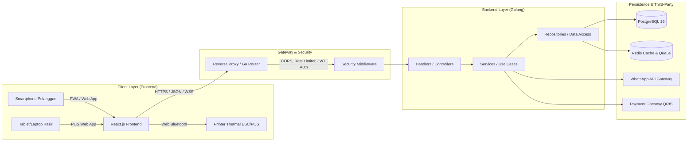

# TECH STACK SPECIFICATION — kucek.id
## Modern Laundry Management Platform (Golang + React.js)

* **Document Version:** 1.0.0
* **Date:** 2026-11-27
* **Status:** Approved
* **Architecture Pattern:** Decoupled Monorepo (Client-Server Architecture)

---

## 1. Arsitektur Tingkat Tinggi (High-Level Architecture)

Aplikasi **kucek.id** dibangun dengan pemisahan tegas (*separation of concerns*) antara antarmuka pengguna (*Frontend*) dan logika bisnis & data (*Backend*):

```
kucek.id/
├── backend/            # Golang REST API Service (Clean Architecture)
├── frontend/           # React.js SPA / PWA (TypeScript + Tailwind CSS + Shadcn UI)
├── prd.md              # Product Requirements Document
├── tech_stack.md       # Spesifikasi Teknologi (Dokumen ini)
└── rules.md            # Aturan Coding, SOLID & Standar Keamanan
```



---

## 2. Spesifikasi Backend (Golang)

Backend ditulis menggunakan **Go (Golang) versi 1.22+** yang terkenal dengan performa tinggi, efisiensi memori, konkurensi bawaan (*goroutines*), dan keandalan tingkat enterprise.

| Komponen | Pilihan Teknologi | Alasan Pemilihan & Keunggulan |
| :--- | :--- | :--- |
| **Language** | **Go 1.22+ / 1.23+** | Kecepatan eksekusi native, konsumsi RAM sangat hemat, *type-safe*, *concurrency* handal. |
| **HTTP Router / Framework** | **Chi Router (`go-chi/chi/v5`)** atau **Go Standard Library 1.22+ Net/Http** | Ringan, 100% kompatibel dengan `http.Handler` standar, tanpa *black magic*, performa mendekati *bare-metal*. |
| **Database Engine** | **PostgreSQL 16** | Database relasional standar industri untuk transaksi keuangan, integritas referensial (FK/ACID), dan tipe data JSONB. |
| **Database Driver & Toolkit** | **`pgx/v5` + `sqlc` (atau GORM dengan isolasi ketat)** | **Rekomendasi Utama: `sqlc` + `pgx`**. Menghasilkan kode Go yang 100% *type-safe* langsung dari query SQL murni. Nol risiko SQL Injection, tanpa *overhead reflection* runtime. |
| **Database Migration** | **`golang-migrate/migrate`** | Skrip migrasi terkelola (*up & down* SQL files) yang aman dan dapat di-audit (*version controlled*). |
| **Autentikasi & Token** | **`golang-jwt/jwt/v5`** | Standar JWT (JSON Web Tokens) ditransmisikan via **HTTP-only, Secure Cookies** (mencegah XSS). |
| **Password Hashing** | **Argon2id (`golang.org/x/crypto/argon2`)** atau **Bcrypt** | Algoritma hashing terkuat tahan terhadap serangan GPU/ASIC brute-force. |
| **Validasi Request Input** | **`go-playground/validator/v10`** | Validasi payload JSON sebelum masuk ke layer service (email, nomor HP Indonesia, batas angka positif). |
| **Worker / Background Queue** | **`hibiken/asynq` (berbasis Redis)** atau Goroutine Worker Pool | Memproses antrean kirim WhatsApp otomatis dan pengecekan kedaluwarsa kuota tanpa memblokir request HTTP kasir. |
| **Logging Terstruktur** | **`uber-go/zap`** atau Go 1.21+ `log/slog` | Logging terstruktur format JSON dengan performa tinggi untuk audit trail dan monitoring error. |

---

## 3. Spesifikasi Frontend (React.js)

Frontend dibangun sebagai **Single Page Application (SPA) / Progressive Web App (PWA)** modern yang cepat, responsif di HP kasir maupun smartphone pelanggan.

| Komponen | Pilihan Teknologi | Alasan Pemilihan & Keunggulan |
| :--- | :--- | :--- |
| **Framework & Build Tool** | **React 19 / 18 + Vite** | Build cepat (*Hot Module Replacement* instan), ukuran bundle minimalis, ekosistem ekstensif. |
| **Language** | **TypeScript (Strict Mode)** | Menghilangkan bug runtime, kontrak data dengan API Go jelas, auto-completion prima. |
| **Styling & CSS** | **Tailwind CSS v4** | Utility-first CSS, performa kompilasi instan, responsif mobile-first. |
| **Komponen UI** | **Shadcn UI + Radix UI Primitives** | Komponen UI aksesibel (WCAG AA), tanpa dependensi vendor lock-in, kode komponen bisa dikustomisasi 100%. |
| **Icon Pack** | **Lucide Icons (`lucide-react`)** | Ikon modern, ringan, dan lengkap untuk antrean laundry (mesin cuci, hanger, timbangan, nota, dll). |
| **Routing** | **React Router v6 / TanStack Router** | Client-side routing dengan dukungan *protected routes* berbasis role (Superadmin vs Pelanggan). |
| **Server State & Data Fetching** | **TanStack Query v5 (React Query)** | Manajemen caching, background refetching otomatis saat status cuci berubah, optimasi query tanpa *race conditions*. |
| **Form & Validasi** | **React Hook Form + Zod** | Validasi form cepat dan ringan tanpa *re-render* berulang. |
| **Printing Hardware Helper** | **Web Bluetooth API & Web Serial API (ESC/POS)** | Langsung mencetak nota ke printer thermal portable Bluetooth/USB kasir dari browser tanpa driver pihak ketiga. |

---

## 4. Integrasi Pihak Ketiga (Third-Party Services)

1. **WhatsApp Messaging Gateway:**
   * **Provider:** Fonnte / Wablas / Twilio / Official WABA Cloud API.
   * **Protokol:** HTTP REST API untuk kirim pesan nota; Webhook URL di backend Go untuk menerima laporan status pengiriman pesan (*Delivered/Read*).
2. **Payment Gateway (QRIS Otomatis):**
   * **Provider:** Midtrans / Xendit / Tripay.
   * **Protokol:** API pembuatan *Dynamic QRIS* per order & Webhook callback dengan validasi **HMAC SHA-512 Signature** di backend Go.
3. **Cetak Struk Thermal:**
   * Format 58mm & 80mm standar industri (*Receipt Paper Roll*).
   * Generator raw byte commands ESC/POS untuk cetak teks, garis potong, dan QR code resi.

---

## 5. Ringkasan Lingkungan Operasional (Deployment Target)

* **Backend:** Binary Go yang dikompilasi ke single executable file, dijalankan dalam lightweight Docker Container (Alpine / Scratch image, ukuran < 25 MB).
* **Frontend:** Static files (HTML, JS, CSS) hasil `vite build` yang di-serve via Nginx atau CDN (Cloudflare Pages / Vercel).
* **Database:** Managed PostgreSQL (Supabase / Neon / AWS RDS / Self-hosted VPS dengan backup berkala).
* **Cache / Redis:** Upstash Redis atau Redis server lokal untuk antrean worker pesan WhatsApp.
